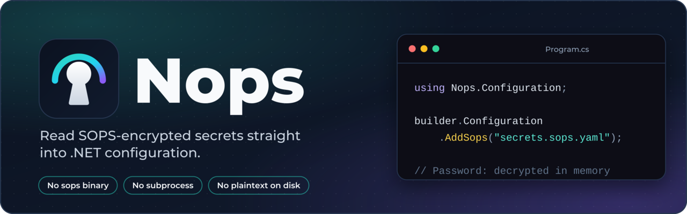
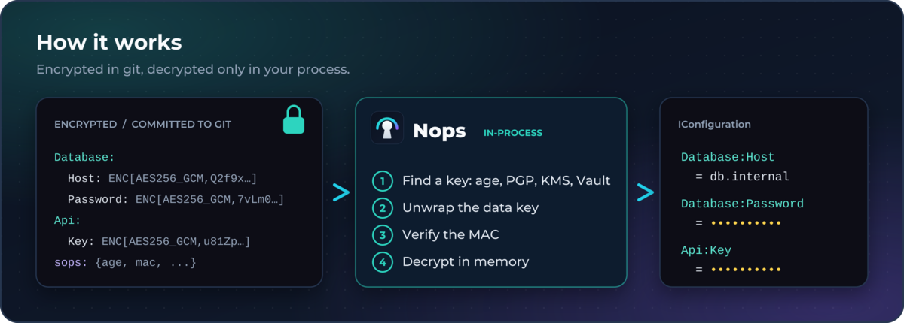
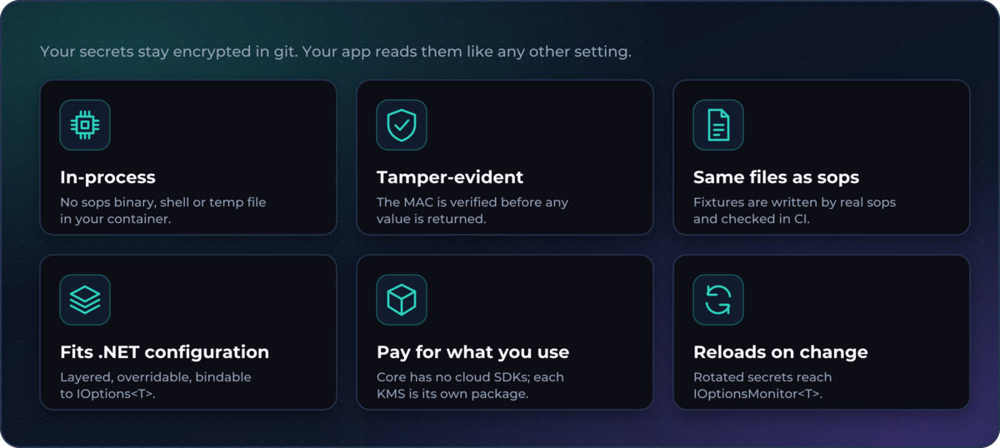

<div class="nops-hero">
  
</div>

<div class="nops-cta">
  <a class="primary" href="../docs/quickstart.md">Get started</a>
  <a href="../docs/deployment.md">Deploy to Kubernetes and Docker</a>
  <a href="api/index.md">API reference</a>
  <a href="https://github.com/atulmish/Nops">GitHub</a>
</div>

**Nops reads [SOPS](https://github.com/getsops/sops)-encrypted files straight into .NET configuration.** No `sops` binary, no subprocess, no plaintext on disk.

You keep encrypting and editing secrets with the `sops` CLI and commit the encrypted files. Your app decrypts them in-process at startup:

```csharp
builder.Configuration.AddSops("secrets.sops.yaml");
```



## Install

```bash
dotnet add package Nops.Configuration   # IConfiguration provider (includes Nops.Core)
dotnet add package Nops.Core            # Decryption API only
```

## Why Nops



## Formats and keys


## Where next

- [Quickstart](../docs/quickstart.md): first decrypt, typed binding, samples
- [Configuration reference](../docs/configuration.md): every option, key flattening, reload, errors
- [Deploying with Nops](../docs/deployment.md): config layout, Kubernetes and Docker, key rotation, troubleshooting
- [Cloud KMS setup](../docs/cloud-kms.md): AWS, GCP, Azure Key Vault, HashiCorp Vault
- [API reference](api/index.md): every public type
